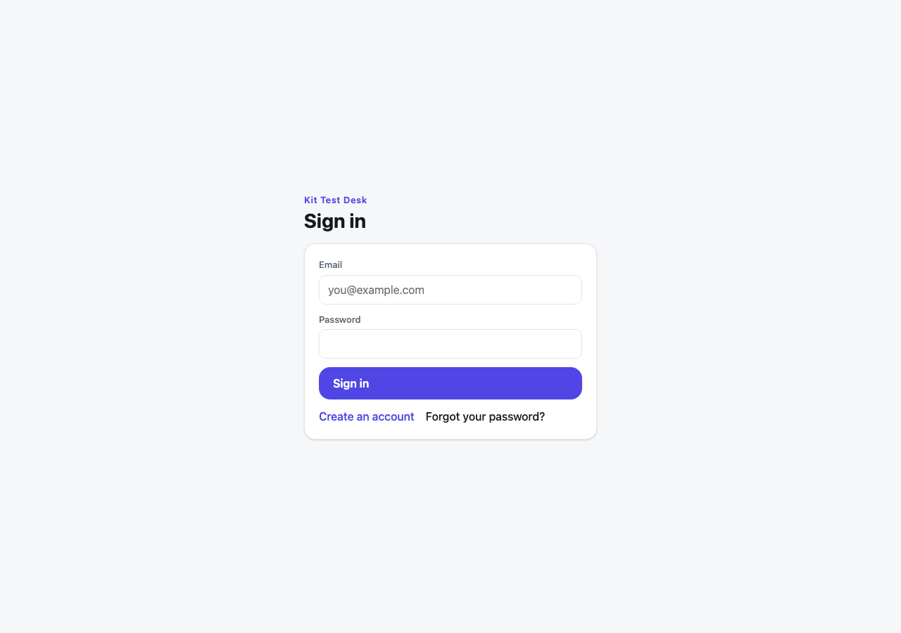
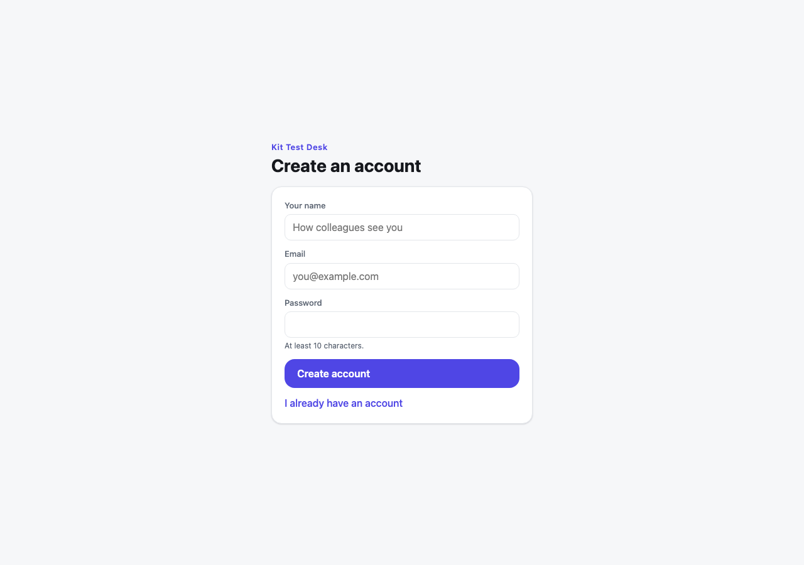
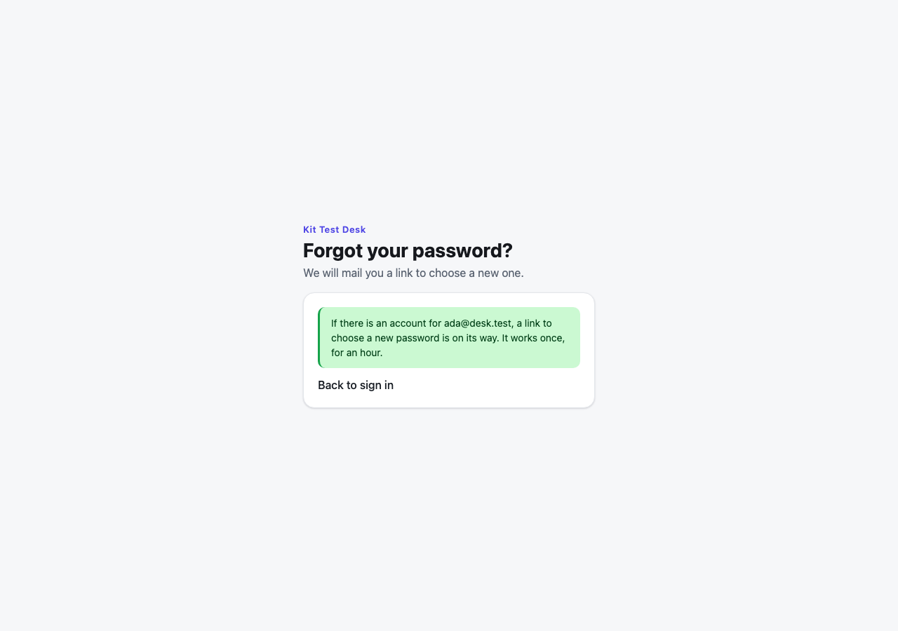
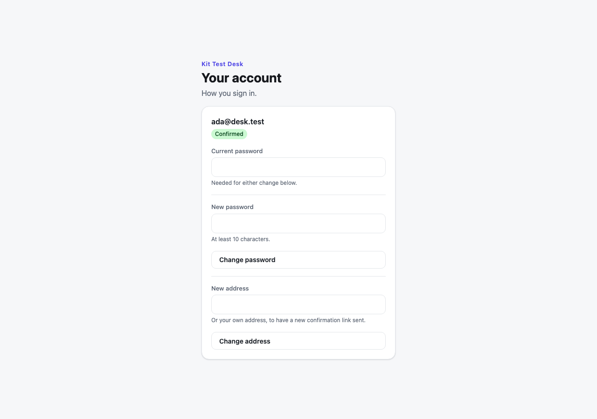
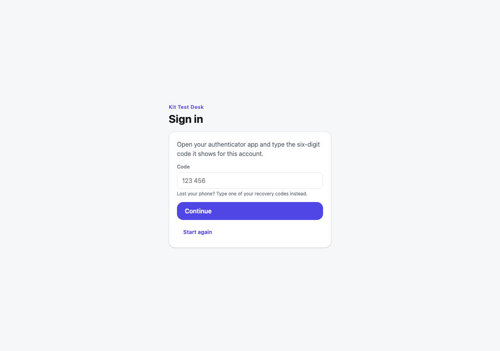
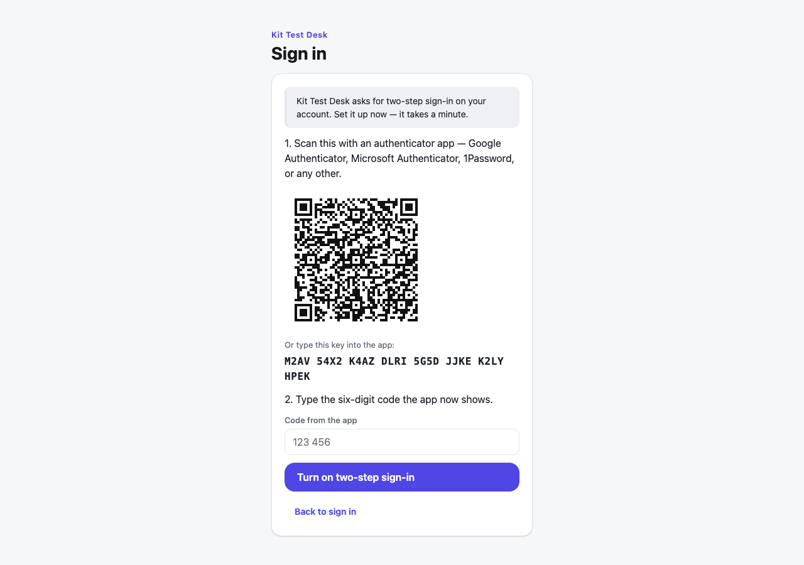
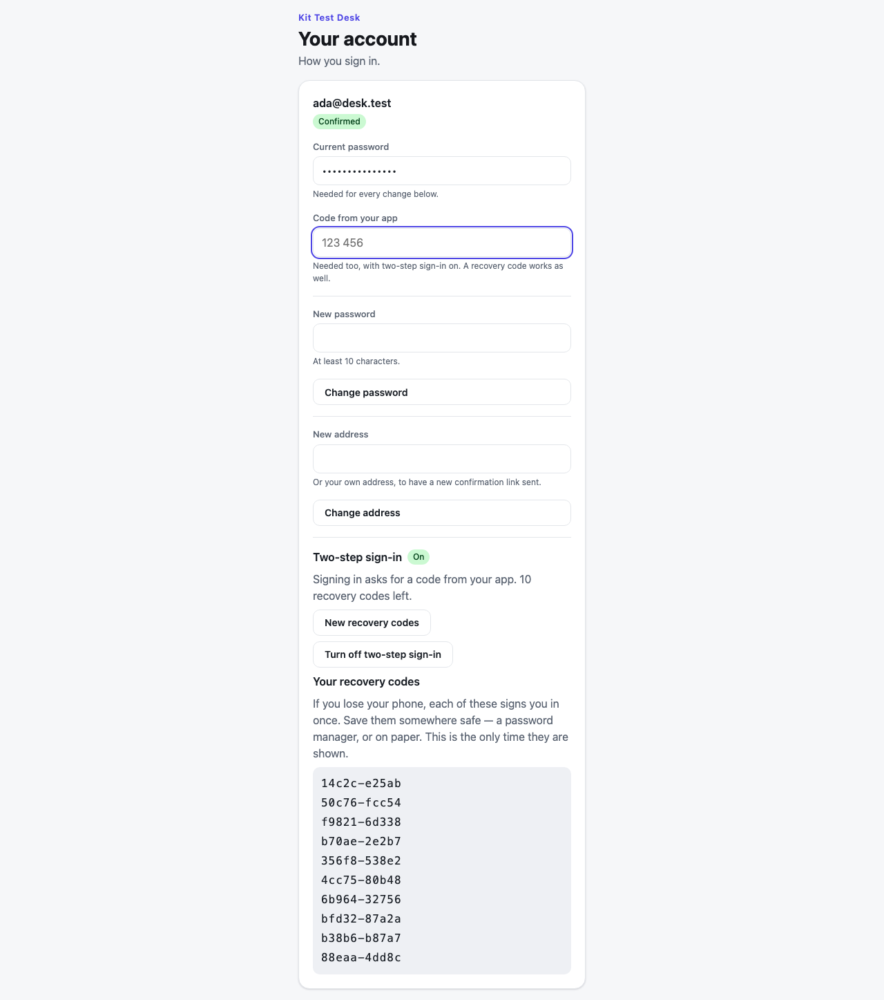

# Osysharp.UserAccounts

Sign-in for a business app, done properly once. Every app that people sign in to needs the same things: sign in, sign
up (or not — some apps are invitation-only), a forgotten password, a changed password, a changed address, and proof
that an address is really theirs. Each of them is easy to get almost right. This kit gets them right, with the pages,
and the app writes **its roles and one setting**:

```osy
// app.osy
use Osysharp.Identity@0;
use Osysharp.Mail@0;
use Osysharp.UserAccounts@1;
use Osysharp.EmailTemplates@0;
use Osysharp.Ui;
use Osysharp.Workflow;
```

```osy
// model/auth.osy
using Osysharp.UserAccounts;

[Role] enum AppRole { Authenticator, Agent, Lead }       // Authenticator: the role the sign-in flow runs as
app.Accounts = new AccountsSetup { AppName = "Acme Support", SignupRole = AppRole.Agent, FirstAccountRole = AppRole.Lead };
```

That is all of it. The kit serves its own pages at its own routes — `/login`, `/sign-up`, `/forgot-password`,
`/reset-password/{token}`, `/verify-email/{token}` and `/account`, the addresses its mail links to — and wires the app's
sign-in (`app.AuthBootstrap`, `app.Auth`) itself, so `osy user add` works and every flow is reachable by a signed-out
visitor.

To use a page of your own instead, declare a component with the kit page's name — it takes the page over, at the
kit's route or wherever your `[Route]` puts it:

```osy
[Route("/login")] [AllowAnonymous] [Render(CSR)]
component SignInPage() { render { MyFrame { SignInForm(); } } }
```

| Sign in | Sign up |
|---|---|
|  |  |

| Forgotten password | The signed-in account page |
|---|---|
|  |  |

Every colour, face and size on these pages is a theme token, so the app's own theme restyles them.

## What it guarantees

- **The password hash is the sign-in flow's alone** — never read or written by anyone signed in, their own included,
  on `User` and on every type an app derives from it.
- **A wrong address takes as long as a wrong password**, and gets the same answer, so sign-in never tells a stranger
  which addresses have accounts.
- **A reset link** is a mailed secret, stored only as a hash, that works once and for one hour. Pressing the button
  twice mails once; using one link spends the others.
- **An address is proven by a message it received.** A change of address a person asks for takes effect only from a
  link sent to the NEW address, and the OLD address is told. Nothing else writes the address — not the account, not
  your staff, not a page or an API call (`deny update Email except via ConfirmAddressChange` on `User`).
- **Your desk can move an account for somebody who lost their address — on the record.** A person the app names
  (`policy ChangesAccountsFor => IsDesk;` — nobody until it does) calls `ChangeAddressFor(account, newAddress,
  reason)` — "ID checked at the desk". The account moves at once; who did it, when and why is kept; the old address is
  told it moved and the new one is welcomed — nothing to click in either.
- **Signing up first with somebody else's address gets you nothing.** The first time an account's address is proven,
  the link or code proves it only together with the password the account was made with (the sign-up and sign-in
  screens pass it along, so the person who made it is not asked again) — or with a NEW password, which hands the
  account to whoever holds the address and clears every way in set up before: the old password, two-step sign-in, a
  phone, linked providers.
- **Erasing an account leaves no way in.** `EraseAccount(account)`, called from your erasure's run, clears the address,
  the name, the password, two-step sign-in, a phone, linked providers, roles, sessions, every link and code sent to it and
  the outbox's copies of that mail — and keeps the row, which work it did still names.
- **One address, one account**, across every kind of account.
- **Sign-up gives only the roles the app chose** (`SignupRole`, and `FirstAccountRole` for the very first account),
  never one the visitor names. `SignupOpen = false` closes it.
- **Changing the password needs the current one**, and the account is told by mail.
- **The hash never reaches the audit trail.**
- **With two-step sign-in on, a password alone signs nobody in** — see below.

## Two-step sign-in

After the password, a six-digit code from an authenticator app on the person's phone — or, when the phone is lost, one
of ten one-time recovery codes. Anybody may turn it on from the account page, and the app says who **must**:

```osy
public class AdminsUseCodes : SecondFactorPolicy {
  public override bool Required(User account) {
    return RoleGrant.Any(g => g.Member == account && (g.Role == AppRole.Admin || g.Role == AppRole.Lead));
  }
}
app.Accounts = new AccountsSetup { AppName = "Acme Support", SecondFactor = new AdminsUseCodes() };
```

Someone who must, and has not set it up, sets it up at sign-in — they are given no ticket until they have.

| The code, after the password | Setting it up | Recovery codes, shown once |
|---|---|---|
|  |  |  |

What holds:

- **No ticket before the second factor.** The password answers a short-lived, single-use challenge (kept only as a
  hash); the code turns it into a ticket. A mailed reset link sets a new password and signs nobody in, and the
  platform's own password sign-in (the CLI's) refuses such an account.
- **A code works once** — a code already used is refused, even inside its minute.
- **Guessing is bounded**: five wrong codes end a challenge, and ten on one account in fifteen minutes stop every code
  check for it, the right one included.
- **The authenticator secret is nobody's but the sign-in flow's**, the account's own included, and is stored sealed
  with the app's own key.
- **Recovery codes** are kept only as keyed fingerprints, work once, and a new set spends the old one. Using one — and
  turning two-step sign-in on or off — mails the owner.
- **Turning it off, or new recovery codes, take the password and a current code**; so, while it is on, do a new
  password or address.

## Settings

```osy
app.Accounts = new AccountsSetup {
  AppName = "…",              SignupOpen = true,           SignupRole = AppRole.…,     FirstAccountRole = AppRole.…,
  MinPasswordLength = 10,     RequireVerifiedEmail = false, HomePath = "/",
  Mails = new AccountMails(), // derive to write your own words for each mail
  Kinds = new AccountKinds(), // derive to make your own kind of account on sign-up
  SecondFactor = new SecondFactorPolicy(),   // derive to say who must use two-step sign-in
  AddressProof = new AddressProofPolicy(),   // derive to say whose address must be proven before a first sign-in
  LogoUrl = "",               // the app's mark on every sign-in screen: File.Url("public/brand/logo.svg"), or https
};
```

## Staff and their roles

A new account gets the role sign-up gives it. A manager giving staff their roles and taking them back — with a record of
who changed what, deactivating somebody who left, signing a person out everywhere — is **Osysharp.UserManagement**, the user
manager. An app with more than one role usually adds it: `use Osysharp.UserManagement@0;`.

## An account for somebody who never signs in

A child a parent books for, a walk-in at the desk: `MakeManagedAccount("Sam")` makes a real account with no password and
no address anybody can mail, recorded with who made it and who looks after it. Who may is the app's to say:
`policy MakesManagedAccounts => IsMember;`. Later, `GiveManagedAccountAnAddress(account, "sam@example.com")` sends a
link; the account moves there once it is opened, and Sam chooses a password like anybody else.

## Your own kind of account

What the app knows about its people goes on a type derived from `User`. Tell sign-up to make it:

```osy
entity Employee : User {
  [MaxLength(60)] string Team = "";
  security {                                     // its own grants — inside the kit's rules, which still hold
    allow read when IsAuthenticated || IsAuthenticator;
    allow create when IsAuthenticator;
    allow update when IsAuthenticated || IsAuthenticator where Id == user.Id;
    allow update when IsAuthenticator;
  }
}
public class StaffKinds : AccountKinds {
  public override User New(string email, string name) { return new Employee { Email = email }; }
}
app.Accounts = new AccountsSetup { AppName = "Acme Support", Kinds = new StaffKinds() };
```

In security rules `user` is the base `Principal`; `user is Employee` tells the kinds apart.

## Mail

Reset links, verifications and notices go through [Osysharp.Mail](https://osyrin.com/templates/kits/mail/)'s outbox. Until the app names a
sender, mail is **held** — kept, with the reason — and the app still signs people up and resets passwords. Name one,
for example Resend:

```osy
app.Mail = new MailSetup {
  Sender = new ResendSender { ApiKey = Security.IsSecretSet("ResendApiKey") ? Secret.ResendApiKey : "" },
  From = "Acme <noreply@acme.com>",
};
app.Secrets = [ new Secret("ResendApiKey") ];
```

## Building your own on top of it

The pieces are separate on purpose. The forms (`SignInForm` — which carries the code step and the set-up step —
`SignUpForm`, `ForgotPasswordForm`, `ResetPasswordForm(token)`, `VerifyEmailResult(token)`, `AccountSettings`,
`SecondFactorEnrolment`, `RecoveryCodeList`) go in any frame of your own. The flows are ordinary functions — `SignIn`,
`SignUp` (both answer a `SignInStep`: a ticket, a challenge, or "set it up first"), `SignInWithCode`, `RequestPasswordReset`,
`ResetPassword`, `ChangePassword`, `ChangeEmail`, `VerifyEmail`, `EnableSecondFactor`, `DisableSecondFactor`,
`NewRecoveryCodes` — and an app that states its own `app.AuthBootstrap` replaces the kit's wiring whole. A sign-in that is
not a password (a company's identity provider, a code by text message) builds on
[Osysharp.Identity](https://osyrin.com/templates/kits/identity/) directly.

Not in this version: signing in with a provider (OAuth), invitations, organisations, a user manager, and passkeys (they
will be a second factor on the same challenge).
